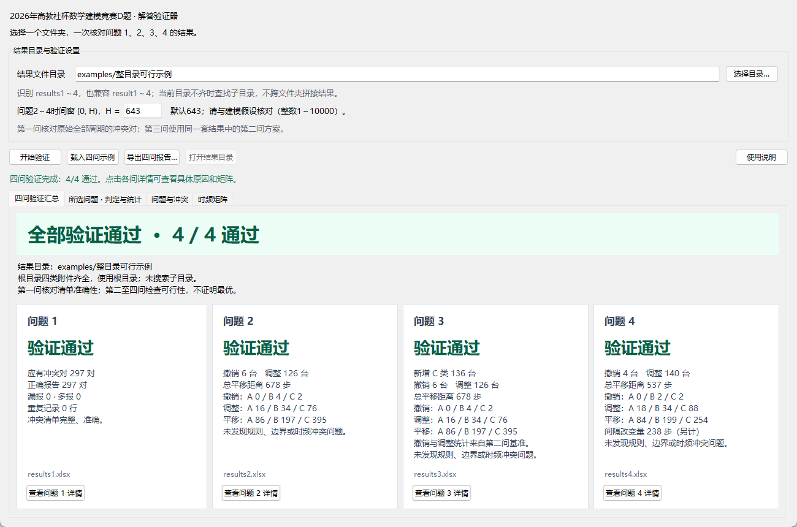
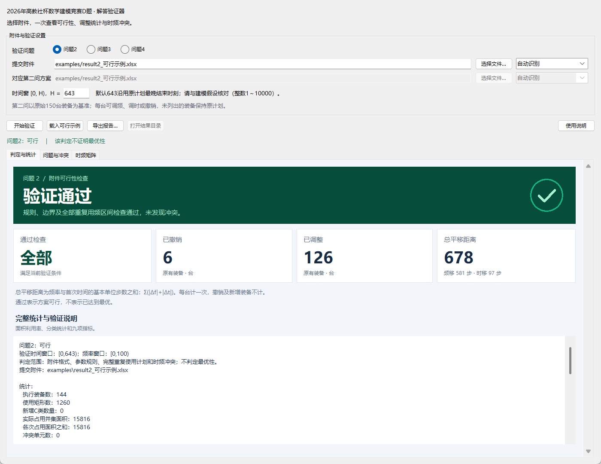
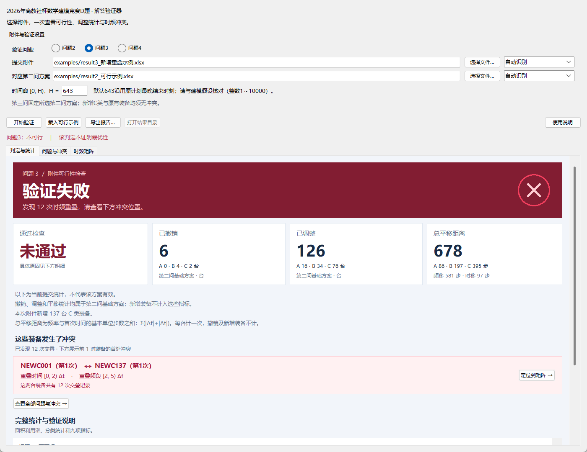
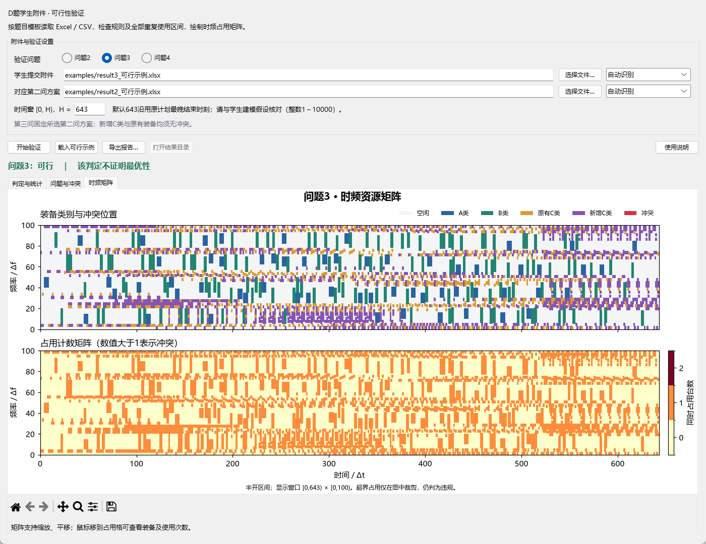

# 2026年高教社杯数学建模竞赛D题 · 解答验证器

本程序基于2026年高教社杯数学建模竞赛D题，用于检查四问的结果附件：第一问有没有找全冲突装备对，第二至四问有没有违反调整规则、重复使用越界或时频冲突。结果可以画成时频矩阵，也可以导出成图片和 Excel 明细。

**v1.4.1：选择一个附件目录，一次查看四问的验证结果。** 支持直接选择存放四份附件的文件夹，也支持从外层文件夹找到唯一一套完整附件。

v1.4.1 修复了部分 Excel 文件明明有表头、却被提示“未找到完整附件表头”的读取问题。

这是一个离线桌面程序，文件在本机读取，不修改提交的原件，也不上传数据。**第二至四问通过检查表示方案可行，不代表已经最优。**

## 下载

**[下载最新版](https://github.com/wwn7268/cumcm-2026-d-validator/releases/latest)**

下载 ZIP 后先完整解压。电脑需要 **Python 3.10 或以上**，以及 Tkinter、openpyxl、numpy、matplotlib。Windows 安装 Python 时请勾选添加到 PATH，并保留 Tkinter 图形组件。

第一次使用，在解压目录打开终端，安装依赖：

```powershell
python -m pip install -r requirements.txt
```

然后双击 **启动验证器.cmd**。也可以运行 `python app.py`。准备好环境后，无需联网。

## 一次验证一整套附件

1. 把同一套方案的 `results1.xlsx`、`results2.xlsx`、`results3.xlsx`、`results4.xlsx` 放在同一个文件夹。
2. 打开程序，选择这个目录，点击 **开始验证**。
3. 查看四问的结果卡片，点击对应的详情按钮，查看统计、冲突记录和时频矩阵。
4. 点击 **导出四问报告**，一次保存整套结果。



想先试一下，点击 **载入四问示例**，再点 **开始验证**。程序会使用 `examples/整目录可行示例` 中配套的四份附件。

文件名也可以用 `result1.xlsx`～`result4.xlsx` 或“问题一”等中文题号，支持 `.xlsx`、`.xlsm`、`.csv`。同一问有多个版本时，会提示 **结果不唯一**，请把要验证的版本单独放进一个文件夹。

所选目录没有集齐四问时，程序会继续查找子目录：找到唯一完整的一套就使用它，找到多套则提示目录不唯一。没有完整子目录时，会检查根目录已有的附件并列出缺失；根目录也没有附件时，只在唯一一个含部分附件的子目录中检查。**不同目录的文件不会拼成一套。**

## 结果怎么看

绿色表示验证通过，红色表示验证失败，橙色表示还没完成检查。看到 **缺少结果**、**结果不唯一** 或目录不唯一时，先按提示整理文件，再验证一次。

第一问核对的是 **297 个冲突装备对**，允许把同一对的前后顺序反过来。漏报、多报、重复填报和无效编号都不能通过。原始计划中有 **431 次交叠事件**；第一问通过表示这些冲突关系报对了，不表示原始计划已经没有冲突。

第二至四问的详情中，直接显示已撤销数、已调整数和总平移距离。第三问自动使用同目录的第二问方案；第二问未通过时，第三问会提示基准不可用。第四问独立验证。

以下详情截图来自旧版界面；新版从四问结果卡片进入相同的详情页。

“已撤销”“已调整”“总平移距离”下面的小字分别列出 A、B、C 类的分项，便于对照总数。前两项以台计，平移距离以步计。



验证失败时，这一页会列出冲突双方的装备编号、各自第几次使用，以及相交的时间和频段。点击 **定位到矩阵** 就能查看冲突位置，全部记录在“问题与冲突”页。橙色的“验证未完成”表示文件还没有完整检查完，请先按提示处理输入问题。



| 题目 | 目录中的附件 |
|---|---|
| 第一问 | `results1.xlsx`：冲突装备对 |
| 第二问 | `results2.xlsx`：调整与撤销方案 |
| 第三问 | `results3.xlsx`：新增装备，自动配合同目录的 `results2.xlsx` |
| 第四问 | `results4.xlsx`：允许修改 C 类间隔的方案 |

第三问按固定第二问布局检查，因此两份附件要属于同一套方案。第四问从原始 150 台装备重新开始，允许 C 类单独改间隔。

时间窗默认 **H=643**，取原计划最晚结束时刻；这是建模假设，请与论文核对，必要时在界面中修改。



矩阵中的红色表示冲突。双击冲突记录可以定位到对应区域，鼠标移到格子上可以查看占用装备。

总平移距离按未撤销装备的调频步数与调时步数相加，每台只计一次；第四问的间隔改变量另列。第三问的撤销、调整和平移统计来自配套的第二问方案。

**详细步骤、使用截图、附件格式和常见问题，请看 [使用说明](使用说明.md)。** 随程序提供的正确、错误附件见 [示例说明](examples/说明.md)。

## 数据来源

程序中的 150 台原始装备参数由题目附件1整理，演示附件由相应模型的求解结果生成。仓库不包含原题 PDF 或使用者提交的文件。
