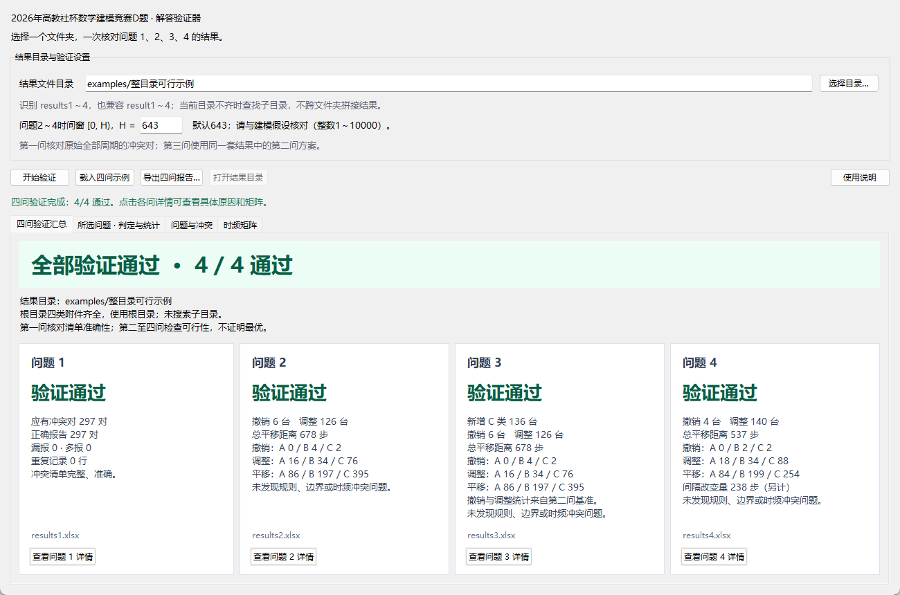
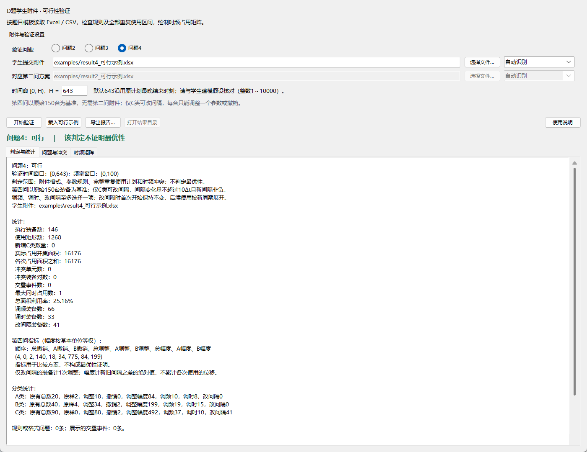
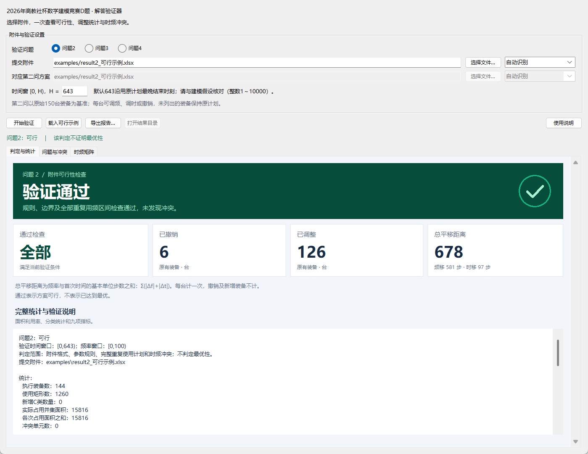
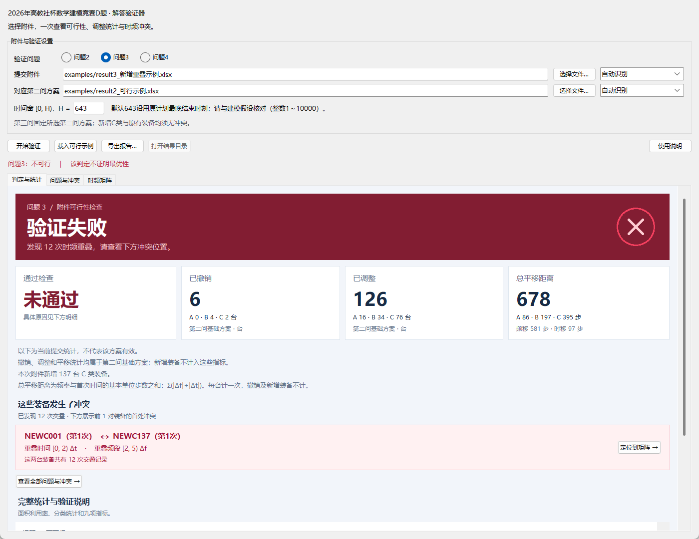
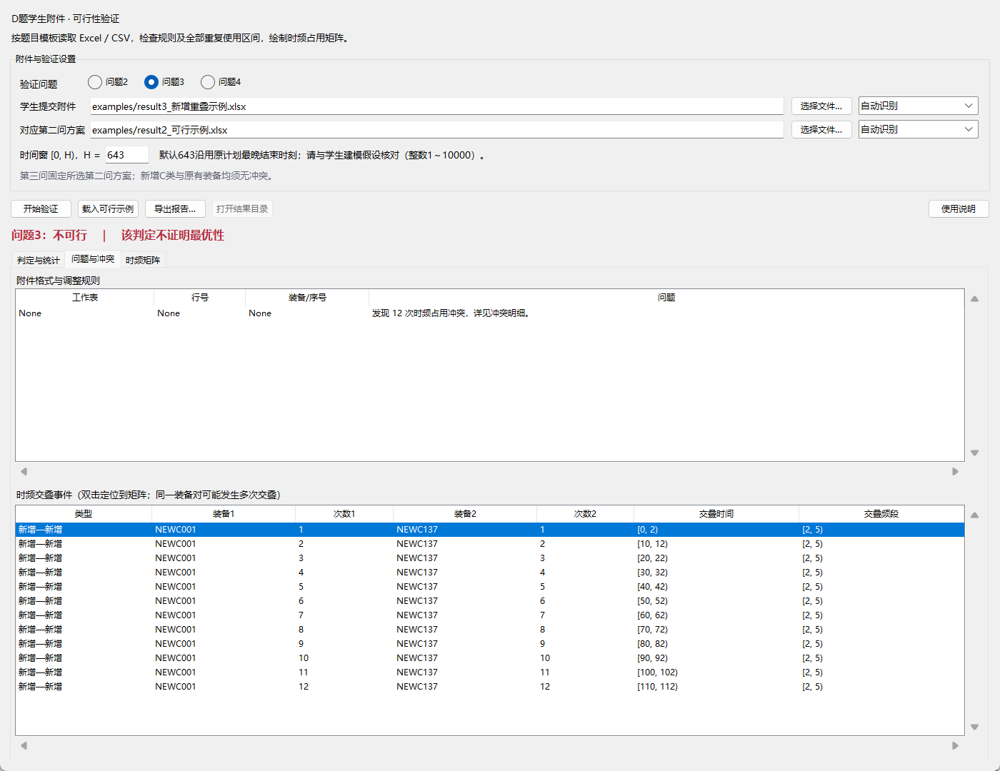
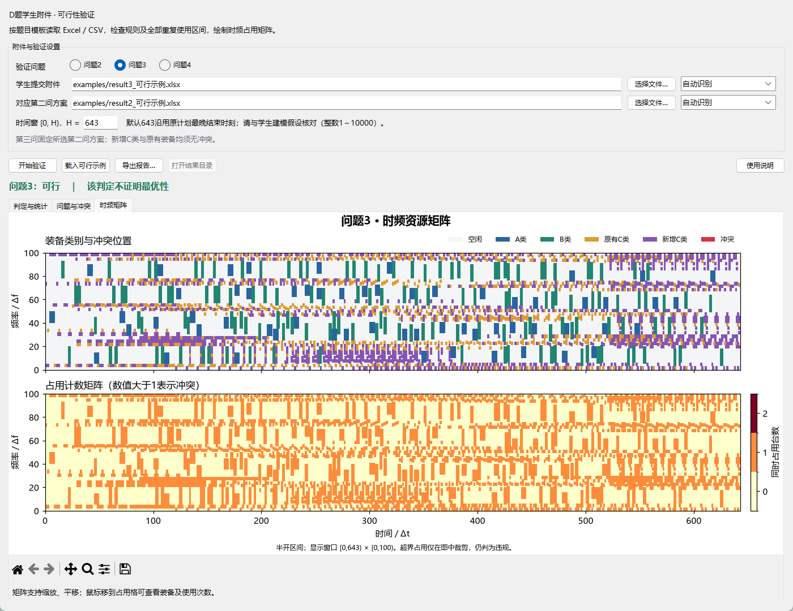

# 2026年高教社杯数学建模竞赛D题 · 解答验证器使用说明

本程序基于2026年高教社杯数学建模竞赛D题，用于检查四问的结果附件。v1.4.1 的界面只需要选择一个目录：第一问核对冲突装备对，第二至四问检查调整规则、边界和冲突，并画出时频占用图。

文件只在本机读取，程序不会改动提交的原件。

## 下载后怎么打开

从 [下载页面](https://github.com/wwn7268/cumcm-2026-d-validator/releases/latest) 取得程序 ZIP，**先完整解压，再运行**。

电脑需要 Python 3.10 或以上，并带有 Tkinter 图形组件。Windows 安装 Python 时，请勾选添加到 PATH；如果这台电脑已经能运行验证器，就不用重新准备环境。

第一次使用，在解压后的文件夹中打开终端，输入：

```powershell
python -m pip install -r requirements.txt
```

安装完成后，双击 **启动验证器.cmd**。以后直接双击它即可，验证和导出都可以离线完成。

也可以在程序目录运行：

```powershell
python app.py
```

## 先用示例试一遍

1. 点击 **载入四问示例**，程序会填好 `examples/整目录可行示例`。
2. 点击 **开始验证**。
3. 查看四问的结果卡片，点击某一问的详情按钮，查看它的统计、冲突和时频矩阵。

这套示例的四问应全部通过。第一问列出 297 个冲突装备对；第二问撤销 6 台、调整 126 台；第三问新增 136 台；第四问撤销 4 台、调整 140 台。

`examples` 里也有故意出错的附件，适合演示如何查错，说明见 [示例说明](examples/说明.md)。

## 一次检查整个附件文件夹

把同一套方案的四份附件放进一个文件夹，推荐命名为 `results1.xlsx`、`results2.xlsx`、`results3.xlsx`、`results4.xlsx`。选好这个目录，点击 **开始验证**。

程序会用四张卡片显示各问结果。点击对应的详情按钮，可以查看详细统计、冲突记录和时频矩阵；点击 **导出四问报告**，可以一次保存整套结果。



`result1`～`result4`、`results1`～`results4` 以及“问题一”“第二问”等中文题号都可以识别，支持 `.xlsx`、`.xlsm`、`.csv`。同一问存在多个候选文件时，会提示 **结果不唯一**，请把要验证的版本单独放进一个文件夹。

使用时留意这几点：

- 第三问自动使用**同目录的第二问方案**。第二问未通过时，第三问会提示基准方案不可用，需要先修正第二问。
- 第四问独立验证，不受第二问是否通过影响。
- 第一问独立核对冲突装备对，不会要求原始计划本身没有冲突。
- 缺少哪一问，会在对应卡片上显示 **缺少结果**，不会把缺失当成验证通过。

### 选的是外层目录，也能找到里面的附件吗？

可以，程序按下面的顺序查找，始终使用同一个目录里的方案：

1. 所选目录已经集齐四问，就直接检查这里。
2. 根目录不全时，继续查找子目录；只有一个子目录集齐四问，就选这一套。有多个完整目录时，会提示目录不唯一，请直接选择需要验证的那个。
3. 没有完整子目录，但根目录已有部分附件，就检查根目录，并列出缺失的问题。
4. 根目录没有附件时，只有一个子目录含部分附件，就检查它并列出缺失；有多个这样的目录时，同样需要你明确选择。

**程序不会把甲目录的第二问和乙目录的第三问拼成一套。** 想直接检查某一套，选择四份文件所在的那一层最方便。

## 每一问检查什么

### 第一问：冲突装备对是否报全

`results1.xlsx` 应列出原始 150 台装备中的 **297 个无向冲突对**。例如 A001 与 B001，写成 B001 与 A001 也可以；但同一对只能出现一次，反向再写一行也算重复。

漏报、多报、重复填报和无效装备编号都会导致验证失败，详情里会指出具体是哪一对或哪一行。

正确示例的第一问详情显示：**应有 297 对、正确 297 对、漏报 0 对、多报 0 对**。

原始计划共有 **431 次时频交叠事件**，它们归属于这 297 对装备。第一问验证通过，意思是“冲突关系找对了”，不是“原始计划没有冲突”。因此第一问通过时，矩阵上仍然会有红色重叠区域。

### 第二问：调整与撤销是否符合规则

第二问只需填写调整或撤销的装备。没有出现在表里的装备，程序会保留其原始计划。每台装备只能调频、调时或撤销，至多选一种；调频幅度不超过 10Δf，调时幅度不超过 5Δt。

### 第三问：新增装备能否放进第二问方案

`results3.xlsx` 自动配合同目录的 `results2.xlsx` 验证。

程序先检查第二问方案，再把第三问的新增 C 类装备放进去检查。换了第二问的布局，第三问是否冲突也可能改变，所以这两个文件必须配套。

这里按“第二问的位置已经固定，再加入新装备”的方式验证。如果第三问又重新调整了原有装备，需要先核对论文采用的模型。

### 第四问：允许改间隔后的方案是否可行

第四问从原始 150 台装备重新开始，不包含第三问新增的装备。除了调频、调时和撤销，C 类还可以改间隔；每台装备仍然只能调整一个参数，或者撤销。

C 类的新间隔可以取整数 **0～18**，A、B 类的间隔不能改。表中“调整后间隔时长”要填**改完后的值**：原来是 8，改成 7，就填 7；改成 0，就填数字 0。

下图是随程序提供的第四问示例：撤销 4 台、调整 140 台，其中 41 台改了间隔。本文保留的详情截图来自旧版界面；新版从四问结果卡片进入详情，统计含义相同。



### 验证前，核对一下时间窗

界面里的 `H` 默认是 **643**，取自原计划最晚结束时刻。题目没有明确规定这个截止时间，因此要与论文的假设对照；采用其他时间窗时，可以改成相应的整数，范围为 1～10000。

程序会检查每一次重复使用是否都落在时间 `[0,H)`、频率 `[0,100)` 内。只看首次使用时间，可能漏掉后续越界。

## 结果怎么看

### “判定与统计”：先看结论，再看数量

- **绿色“验证通过”**：第一问的冲突对报告正确，或第二至四问通过了当前设置下的规则、边界和冲突检查。
- **红色“验证失败”**：已发现违反规则、越界或冲突的地方，原因就列在这一页。
- **橙色“验证未完成”**：文件没有完整读入，或缺少必要的数据，先按提示修正附件，再验证一次。



上图是随程序提供的第二问示例：撤销 6 台、调整 126 台，总平移距离为 678 步。

第二至四问详情里的四张统计卡片可以这样读：

| 卡片 | 看什么 |
|---|---|
| 通过检查状态 | 本次检查是否通过；有输入问题时，先处理提示再看统计 |
| 已撤销 | 撤销了多少台装备的计划 |
| 已调整 | 未撤销装备中，有多少台改了参数；第四问改间隔也算调整 |
| 总平移距离 | 未撤销装备的调频步数与调时步数之和，每台装备只计一次 |

“已撤销”“已调整”“总平移距离”的总数下面，还会用小字列出 **A、B、C 类的分项**。例如第二问示例：撤销为 A 0、B 4、C 2 台；调整为 A 16、B 34、C 76 台；平移为 A 86、B 197、C 395 步。每行三项相加就是卡片上的总数。

检查未完成时，分类统计也显示“—”，不会把未知数量写成 0。

例如，一台装备调频 3Δf，另一台调时 2Δt，这张卡显示的总平移距离就是 **5 步**。它是按基本单位统计的 `Σ(|Δf步数| + |Δt步数|)`，不按重复使用次数累加，也不是图上连线的几何距离。

第四问改间隔的幅度**另列**，不混进“总平移距离”。例如间隔从 8 改成 6，间隔改变量计 2；后续各次使用的累积位移不再逐次相加。详细统计中的“总调整幅度”仍包含调频、调时和改间隔三部分。

第三问的撤销、调整和平移三项统计来自**配套的第二问基础方案**；新增 C 类装备的数量另行显示，不算成对原装备的调整。

第二至四问验证通过表示当前方案可行，**不代表已经最优**。第二、四问的详细统计保留九项指标：总撤销、A 撤销、B 撤销、总调整、A 调整、B 调整、总幅度、A 幅度、B 幅度，便于比较不同方案。

### 验证失败：直接看是哪两台装备撞在一起

发生冲突时，结果页会直接列出**双方装备编号、各自第几次使用、相交的时间区间和频段**。先看这几项，就能回到附件找到对应计划。点击该记录的 **定位到矩阵**，还可以跳到图中查看重叠位置。



上图故意重复填写了一条第三问新增计划：NEWC001 与 NEWC137 的位置相同，12 次使用都发生交叠。结果页可以看到冲突双方和区间，再点“定位到矩阵”查看图中的对应位置。

如果失败原因是调整超限、越界等其他问题，这一页也会给出提示。冲突较多时，切换到“问题与冲突”查看全部记录；修正附件后，重新点击 **开始验证**。

### “问题与冲突”：找到要改的地方

这里会列出错误所在的工作表、行号、装备编号，以及发生冲突的时间和频段。

**双击一条冲突记录，可以定位到矩阵对应区域。** 同一对装备可能在不同使用次数上发生多次冲突，因此表中可能出现多条记录。

下图故意把一条新增计划重复填写，用来演示冲突提示。



### “时频矩阵”：看完整排布

横轴是时间，纵轴是频率。上图用不同颜色区分 A、B、原有 C 和新增 C，**红色表示同一格被重复占用**；下图显示每格的占用次数。



图下方工具栏可以放大、平移、恢复全图。把鼠标移到格子上，还可以查看占用它的装备及第几次使用。

区间采用 `[起点,终点)` 的写法，边界相接不算冲突。例如 `[0,2)` 和 `[2,4)` 可以前后衔接。

面积利用率按下面的式子计算：

> 面积利用率 = 实际占用区域的并集面积 ÷ (100 × H)

空闲间隔不计入面积。有冲突的格子在面积中只算一次，冲突会另外列出。如果文件有格式错误或存在越界，图中只能显示能读出的、位于窗口内的部分，此时以判定结果和错误明细为准。

## 怎么保存结果

点击 **导出四问报告**，选择保存位置。程序会保存四问汇总，并为已完成检查的问题保存各自的报告，包括：

- **时频占用矩阵.png**：可以放进讲义、论文或课件。
- **验证明细.xlsx**：统计结果、错误行、冲突记录和重建后的计划。
- **占用计数矩阵.csv**：每个时频格子的占用次数。
- **验证摘要.txt**、**验证报告.json**：文字摘要和完整结果。

导出后，点击 **打开结果目录** 就能找到这些文件。

## 附件怎么填

优先使用题目给出的 Excel 模板，支持 `.xlsx`、`.xlsm`、`.csv`。一个文件有多个工作表时，程序按表头识别；请保留一份明确的结果，避免放入多个版本。

### 第一问表头

| 序号 | 冲突装备1 | 冲突设备2 |
|---|---|---|
| 1 | A001 | B001 |

每行填一对装备。同一对无论正向还是反向，都只填一次。不要把同一对装备的不同使用次数分别填成多行。

### 第二问表头

| 用频装备编号 | 调整后频段区间 | 调整后时间区间 | 是否撤销用频计划 |
|---|---|---|---|
| A001 | [75,85) | | |
| B002 | | | 是 |

每个编号只写一行，未调整的栏目留空。频段和时间都要保持原来的宽度或时长。

### 第三问表头

| 新增用频装备序号 | 调整后频段区间 | 调整后时间区间 |
|---|---|---|
| 1 | [0,3) | [0,2) |

这里只填新增 C 类装备。表中的时间是**首次使用区间**，程序按频宽 3、单次时长 2、间隔 8、使用 12 次展开完整计划。

### 第四问表头

| 用频装备编号 | 调整后频段范围 | 调整后时间区间 | 调整后间隔时长 | 是否撤销用频计划 |
|---|---|---|---|---|
| C001 | | | 7 | |
| B002 | | | | 是 |

间隔指“本次结束到下次开始”的空闲时长，重复周期等于“单次时长 + 间隔”。只改间隔时，首次开始时间不动，后续按新周期展开；后续累积位移不受调时 ±5 的限制，但仍须满足边界和无冲突要求。

以上几行仅演示填写格式，不是一份完整的可行解。各问都要保持题目规定的频宽、单次时长和使用次数；第二、三问还要保持规定的间隔。

## 常见小问题

**双击后窗口一闪就没了，怎么办？**

在程序文件夹打开终端，运行 `python app.py`，就能看到报错。如果提示找不到 Python，检查是否安装并加入 PATH；如果提示缺少模块，运行前面的依赖安装命令。

**表里用了 Excel 公式，为什么不接受？**

请把结果复制后“选择性粘贴为值”，另存一份再验证。程序不读取公式，避免读到未更新的计算结果。

**区间明明填了，还是报格式错误？**

写成 `[75,85)`，两个端点都用整数，并放在同一个单元格里。如果提交 CSV，带逗号的区间要保留在一个字段内，直接从 Excel 另存为 CSV 通常更方便。

**旧版 .xls 能用吗？**

先用表格软件另存为 `.xlsx`。

**第二问通过，第三问却有很多冲突？**

先检查同目录的第二问附件是否配套，再看冲突明细。第三问必须检查新增装备的全部 12 次使用，也要检查新增装备之间的冲突。

**能在 GitHub 网页里直接使用吗？**

目前是本地桌面程序，需要下载后运行。更新版本时，先关闭旧窗口，再打开新版本。

## 命令行用法

验证整个附件文件夹，在程序目录运行：

```powershell
python -X utf8 validate.py --directory "附件目录"
```

验证单份附件，仍可使用原来的命令：

```powershell
python -X utf8 validate.py 2 "examples/result2_可行示例.xlsx"
python -X utf8 validate.py 3 "examples/result3_可行示例.xlsx" --base-q2 "examples/result2_可行示例.xlsx"
python -X utf8 validate.py 4 "examples/result4_可行示例.xlsx"
```

可选参数：`--horizon 643`、`--sheet Sheet1`、`--base-sheet Sheet1`、`--output 输出目录`。报告写入新的子目录。退出码 0 表示可行，1 表示不可行，2 表示输入错误或校验未完成。
